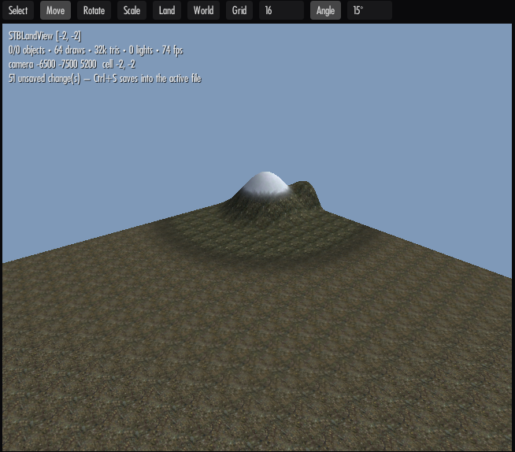
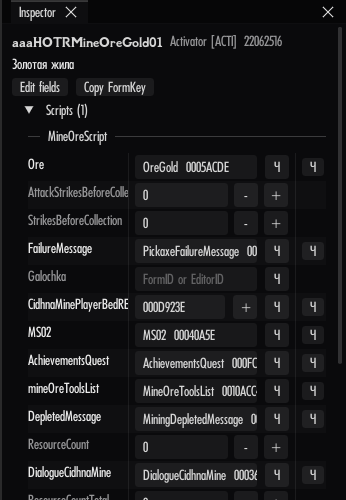
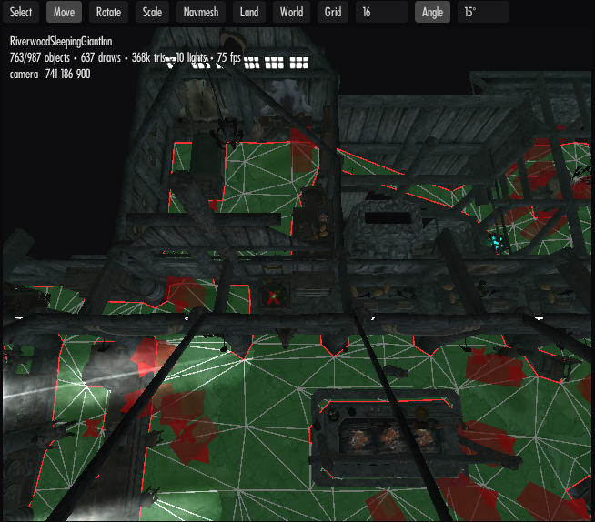

# STB Editor

Современная замена Creation Kit для Skyrim SE / AE / VR: расстановка объектов, ячейки и миры,
ландшафт, навмеш, редактирование любых записей, скрипты и их свойства (без компиляции).
Плагины ESP / ESM / ESL, header 1.70 и 1.71 (с BEES — и на SE).

Не требует запуска через MO2: профиль MO2 читается напрямую, плагины сохраняются в папку мода.

- План и решения — [docs/PLAN.md](docs/PLAN.md), разбор CK и концепта SkyrimMapEditor — [docs/ANALYSIS.md](docs/ANALYSIS.md).
- Для разработчиков (сборка, устройство, проверки, как добавлять функции) — [docs/DEVELOPING.md](docs/DEVELOPING.md).
- Рендер: шейдеры, эффекты, частицы, что приближено — [docs/RENDERING.md](docs/RENDERING.md).

## Состояние

| Этап | Что | Статус |
|---|---|---|
| 0 | Load order (MO2 / Data), индексы как в игре, BSA + loose, каталог записей, Object Window, Cell View (ячейки и их объекты), Inspector, Load Order; интерфейс на русском и английском, справка по клавишам (F1) | готово |
| 1 | NIF, 3D-окно: интерьеры, экстерьеры с ландшафтом и водой, свет ячейки и точечные источники, выбор кликом, камера как в CK, подгрузка экстерьера за камерой; огонь, дым и прочие частицы, анимация эффектов; NPC и существа (одежда, FaceGen-лица, в позе привязки) | готово |
| 2 | Расстановка, сохранение в активный файл, undo/redo, каталог с 3D-миниатюрами, свойства рефов (флаги, enable parent, владелец, замок, телепорт, linked refs) | готово |
| 3 | Редактор полей любой записи, дублирование, скрипты и их свойства (из .pex, автозаполнение) | готово; редактор условий (CTDA), Use Info — дальше |
| 4 | Ячейки, миры, ландшафт | новые интерьеры и миры, ячейки по месту; кисти высот, покраска текстурами, плоская земля — готово; свойства существующих ячеек, vertex color, регионы — дальше |
| 5 | Навмеш (ручная правка) | показ, выбор, перенос, удаление, создание треугольников, флаги — готово; генерация и finalize (NAVI) — дальше |

## Скачать

Готовая сборка — на странице [Releases](https://github.com/STB-Team/STB-Editor/releases/latest):
скачать `STBEditor-<версия>.zip`, распаковать в любую папку (например `<игра>\STB Editor\`) и запустить
`STBEditor.exe`. Ставить .NET не нужно. В MO2 можно добавить `STBEditor.exe` как исполняемый файл, но не обязательно —
профиль MO2 редактор читает сам.

## Сборка и запуск

Нужен .NET SDK 10.

```powershell
dotnet build STB-Editor.sln -c Release
src\Editor.App\bin\Release\net10.0-windows\win-x64\STBEditor.exe
```

Готовый портативный архив: `package.ps1` → `dist\STBEditor-<версия>.zip` (распаковать в любую папку,
в MO2 добавить `STBEditor.exe` как исполняемый файл, как Creation Kit).

Ключи: `--game <папка игры>`, `--mo2 <папка|none>`, `--profile <имя>`, `--open` (без диалога),
`--search <текст>`, `--select <FormID>`, `--cell <EditorID|FormID>`, `--screenshot <файл.bmp>` (кадр после загрузки и выход).
Отладочные ключи — в [docs/DEVELOPING.md](docs/DEVELOPING.md).

Настройки, кэш каталога, логи и бэкапы — `%LOCALAPPDATA%\STBEditor`.

## Интерфейс

- **Вид → Language / Язык** — русский или английский, переключается сразу.
- **Справка → Клавиши и функции** (F1) — все клавиши и что где делается.
- **Вид** — какие окна открыты (Log и Load Order по умолчанию закрыты), ограничение FPS (по умолчанию 60,
  в фоне 15), сброс раскладки окон.
- **Cell View**: слева ячейки выбранного мира, справа — объекты загруженной ячейки (для экстерьера —
  центральной или выбранной слева); клик по объекту выделяет его и наводит камеру, фильтр по EditorID / типу / FormID.
- Слабый ПК: на панели Render Window выключить **FX** и **Anim**, уменьшить **grid ±N** (сколько ячеек
  экстерьера грузится вокруг). Меши и текстуры, которые давно не видны, выгружаются сами, когда занимают
  больше своей доли видеопамяти.

## Управление в Render Window

Камера (как в CK + полёт):

| Действие | Как |
|---|---|
| Загрузить ячейку | двойной клик в Cell View |
| Пройти через дверь | двойной клик по двери с телепортом (или Inspector → Телепорт → «К связанной двери») — откроется ячейка, куда она ведёт, камера у маркера |
| Вращать вокруг выделения (без выделения — осмотреться) | Shift + мышь |
| Панорама | Пробел + мышь или СКМ |
| Зум | колесо (Shift — быстрее, Ctrl — медленнее) |
| Полёт | ПКМ по пустому месту + WASD, Q/E вниз/вверх, колесо при ПКМ — скорость |
| Орбита | Alt + ЛКМ |
| Показать выделенное / вид сверху | C или двойной клик / T |

Объекты:

| Действие | Как |
|---|---|
| Выбрать | ЛКМ, Ctrl+ЛКМ — добавить/убрать |
| Двигать по земле (как в CK) | ЛКМ-перетаскивание выделенного; с зажатой Z — по высоте; X / Y — только по оси |
| Вращать (как в CK) | ПКМ-перетаскивание выделенного (ось Z; с X / Y — по другим осям) |
| Масштаб | S + ЛКМ-перетаскивание |
| Гизмо | Q выбор, W перемещение (стрелки), E поворот (кольца), R масштаб; L — мировые/локальные оси |
| Привязка | G — к сетке (шаг на панели), угол — кнопка Angle |
| Уронить на землю | F |
| Удалить | Delete |
| Отменить / вернуть | Ctrl+Z / Ctrl+Y (Edit → Undo показывает, что именно) |
| Точные значения | Inspector → Placement (позиция, поворот в градусах, масштаб) |
| Маркеры / границы ячеек / каркас | M / B / Shift+W |
| Поставить объект | перетащить из Object Window (список или плитки) или из Preview в Render Window |
| Дублировать | Ctrl+D (копия на том же месте, сразу выделена — тащи) |

Панель Render Window: режим (Lit / Unlit / Normals / Untextured), Wire, Markers, Disabled, Water, Land,
Fog, Borders, **FX** (частицы: огонь, дым, пыль, искры), **Anim** (анимация пламени, текущей воды и частиц;
выключить — кадр замрёт и процессор отдохнёт), **NPC** (подсветка NPC и существ, чтобы их было видно в тёмных
интерьерах; включена по умолчанию).

## Сохранение (как в CK)

- **File → Active File...** — выбрать плагин, куда пишутся правки, или создать новый (имя, флаги ESL/ESM;
  ESL по умолчанию выключен).
  Новый плагин создаётся в `overwrite` MO2 (без MO2 — в `Data`); в MO2 его можно оформить в мод: правый клик по Overwrite → Create mod.
- **Ctrl+S** — сохранить в активный файл; если активного нет, сначала спросит, куда.
- Перед заменой: запись во временный файл, проверка чтением, бэкап в `%LOCALAPPDATA%\STBEditor\backups\<плагин>\` (последние 30).
- Нетронутые записи существующего плагина сохраняются **байт-в-байт**; если правке нужен новый мастер,
  файл переписывается целиком и редактор сначала спрашивает.
- Изменённый реф из чужого плагина → override в активном файле; «удалённый» чужой реф → безопасно отключён
  (initially disabled, enable parent = игрок, z = −30000); свой реф — удаляется по-настоящему.

## Новые ячейки и миры

- **World → New Interior Cell...** — Editor ID, имя, освещение (шаблон освещения или свои цвета и туман).
  Ячейка сразу открывается в Render Window — перетаскивай в неё объекты.
- **World → New Worldspace...** — Editor ID, имя, климат, вода и её высота, высота земли по умолчанию,
  «small world», сколько ячеек создать вокруг (0, 0).
- Поставил объект в мире там, где ячейки ещё нет, — ячейка создаётся сама (как в CK).
- Новые ячейки видны в Cell View с пометкой **new**; всё попадает в активный файл при Ctrl+S, Ctrl+Z отменяет создание.

## Ландшафт (как Landscape Edit в CK)



- **H** или кнопка **Land** на панели Render Window — режим ландшафта; настройки — в панели **Landscape**
  (вкладка рядом с Preview).
- Кисти: **Raise / Lower** (Shift меняет направление), **Flatten** (к высоте, где начат мазок), **Smooth**,
  **Paint** (выбранная текстура ландшафта из списка с превью). Радиус и сила — ползунками.
- ЛКМ-перетаскивание по земле; один мазок — один Ctrl+Z. Края соседних ячеек сшиваются, швов нет.
- Покраска базовой текстуры четверти ячейки стирает слои над ней; в одной четверти — до 6 слоёв (ограничение игры).
- **Create flat land** — плоская земля заданной высоты во всех загруженных ячейках без земли (для новых миров).
- Высоты хранятся в игре с шагом 8 единиц и перепадом не больше 127 шагов между соседними точками —
  более крутые обрывы обрезаются (ограничение формата LAND).

## Свойства рефа, записи и скрипты (Inspector)

Выделенный реф в Render Window — в Inspector:
- **Placement** — позиция, поворот в градусах, масштаб.
- **Reference** — флаги (Persistent, Initially disabled, Visible when distant…), **Enable parent**
  (с «Opposite» и «Pop in»), **Ownership** (NPC или фракция + ранг), **Lock** (уровень, ключ, leveled),
  **Teleport** (дверь назначения, маркер; **Link with a door…** — кликни вторую дверь, можно в другой
  ячейке: обе двери получат телепорт друг на друга, маркеры перед дверями), **Linked references**,
  количество предметов, радиус света.
- **Scripts** — скрипты рефа и их свойства.

Поля-ссылки: впиши FormID или EditorID, перетащи форму из Object Window, или нажми **+** и кликни
реф в Render Window (Esc — отмена). **x** очищает.

Любая запись (базовая или реф): **Edit fields** — дерево всех полей становится редактируемым
(строки, числа, флаги, перечисления, ссылки, цвета, координаты; списки: + add / − last).
**Duplicate** — копия базовой записи с новым FormID и EditorID в активном файле: она сразу
появляется в Object Window и её можно ставить в мир.



Скрипты (как вкладка Scripts в CK): список прикреплённых скриптов, свойства из скомпилированного
.pex (тип, описание), значения из плагина; незаданные — серым. **Add** — прикрепить скрипт по имени
(подсказки из всех .pex сборки), **Auto-fill** — заполнить объектные свойства, чьё имя совпадает с
EditorID формы, **Remove script**. Скрипты не компилируются: нужен готовый .pex.

Каждое изменение — один Ctrl+Z; сохраняется в активный файл как override (байт-в-байт для остального).

## Навмеш



- **N** или кнопка **Navmesh** — режим навмеша (кнопка **Navmesh** справа на панели только показывает его).
  Панель **Navmesh** (вкладка рядом с Preview) — что выбрано, флаги, операции.
- Цвета: зелёный — проходимо, жёлтый — preferred, синий — вода, оранжевый — дверь, фиолетовый —
  без крупных существ, пурпурный — выбрано. Рёбра: красные — открытая граница, светло-голубые —
  связь с соседним навмешем.
- Клик — вершина или треугольник (Ctrl добавляет), перетаскивание — перенос (с зажатой Z — по высоте),
  **Shift+клик** по земле — новая вершина; если выбраны две вершины, сразу и треугольник (так полоса
  растёт клик за кликом). **Del** — удалить, **F** — опустить на землю, в панели — «Triangle from 3
  vertices», «Merge vertices», флаги Water / Preferred / No large creatures / Overlapping.
- После каждой правки пересчитываются соседства треугольников, границы и сетка поиска; связи
  загруженных соседних навмешей перенумеровываются. Первая вершина в ячейке без навмеша создаёт новый NAVM.
- Пока нет генерации и finalize: карта навмешей (NAVI) и связи дверей не обновляются — для новых
  навмешей и удалений рядом с дверями после правок нужен finalize в CK.

## Каталог объектов

- Object Window: для объектов, которые ставятся в мир, кнопка **Tiles / List** — плитки с готовыми 3D-миниатюрами.
- **Preview**: выбранный объект в 3D — ПКМ крутить, колесо зум, двойной клик сброс, Spin — вращение; ЛКМ-перетаскивание ставит объект в мир.

## Лицензия

Будет GPL-3.0 (Mutagen — GPL-3.0).
