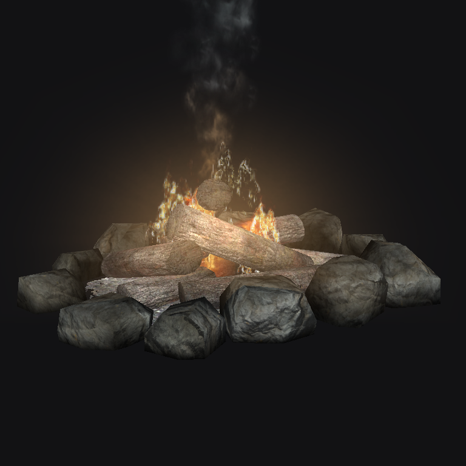
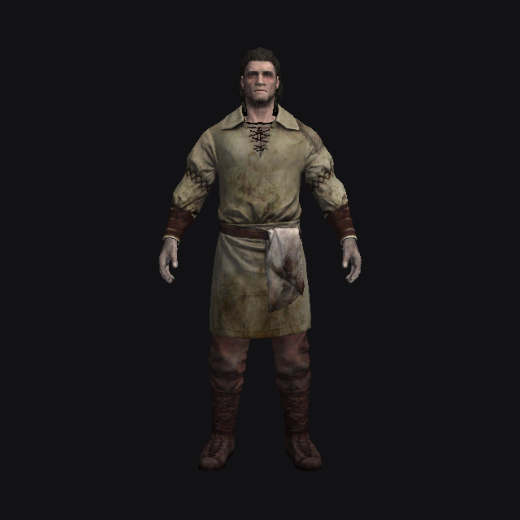
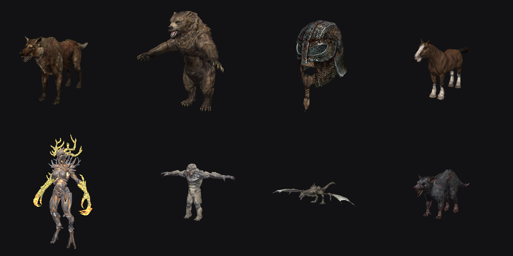

# Рендер

`Editor.Render/SceneRenderer.cs` + HLSL в `Shaders.cs`. Цель — «близко к игре» с переключением
режимов как в CK, а не точная копия игрового конвейера.

## Кадр

1. Константы кадра: камера, солнце/амбиент из XCLL/LGTM ячейки, туман, до 32 ближайших точечных
   источников, оси камеры (для билбордов и частиц), время анимации.
2. Ландшафт: базовый слой + альфа-слои по квадрантам.
3. Непрозрачные шейпы — инстансингом (одна отрисовка на шейп для всех рефов модели).
4. Вода — плоскости.
5. Прозрачные шейпы и частицы — сортировка от дальних к ближним; части одного объекта держат порядок NIF.
6. Маркеры, обводка выделения, линии (радиус света, границы ячеек).

Reversed-Z, бесконечная дальняя плоскость; треугольники NIF — CCW.

## Материалы

- **BSLightingShaderProperty** — diffuse, нормали (tangent / model-space), specular, glow map,
  own emit, hair tint. Освещение — Ламберт + Блинн, без теней.
- **BSEffectShaderProperty** — как в игре (сверено с `Community Shaders/Shaders/Effect.hlsl`):
  - базовый цвет = emissive colour × цвет вершины (rgb и альфа);
  - альфа = (альфа текстуры, или 1 при greyscale-to-alpha) × альфа базового цвета × альфа материала;
  - **greyscale to palette alpha**: альфа = палитра(u = альфа текстуры, v = альфа);
  - **greyscale to palette color**: цвет = emissive multiple × палитра(u = зелёный канал текстуры, v = красный канал базового цвета);
  - иначе цвет = базовый цвет × emissive multiple × текстура.
  Палитры двумерные (например 512×128): сверху тёмные/прозрачные строки, снизу яркие.
- Refraction (марево) не рисуется: в слоте diffuse там карта нормалей.
- NiAlphaProperty: blend-факторы из флагов, alpha test с порогом.

## Анимация шейдеров

`BSEffectShaderPropertyFloatController` / `BSLightingShaderPropertyFloatController` → `NifFloatAnimation`:
U/V offset и scale (бегущая вода, листание атласа пламени), alpha, emissive multiple. Ключи NiFloatData
(линейные, ступенчатые; квадратичные и TBC считаются линейно), время по NiTimeController
(frequency, phase, start/stop, loop / reverse / clamp). Цветовые контроллеры и NiTransformController
пока не проигрываются.

## Билборды

Шейпы под `NiBillboardNode` хранятся в собственной системе координат узла (масштаб без поворота) вокруг
его позиции. Вершинный шейдер ставит локальные X/Y в правую/верхнюю ось экрана, +Z — к камере
(ALWAYS/RIGID_FACE_CAMERA/CENTER), или крутит вокруг оси «вверх» узла (ROTATE_ABOUT_UP).
Пикинг билборды пропускает, в габариты для «уронить на землю» и кадрирования Preview они не входят.

## Частицы

`NiParticleSystem` / `BSStripParticleSystem` разбираются в `NifParticleSystem` (`NifFile.Effects.cs`):

- эмиттеры box / sphere / cylinder / mesh / array, скорость, склонение и угол с разбросом, радиус, жизнь;
- `NiPSysEmitterCtlr` — частота рождения (константа или ключи) и включённость;
- гравитация (planar / spherical), drag, grow/fade, `BSPSysScaleModifier`, `BSPSysSimpleColorModifier`,
  `NiPSysColorModifier`, вращение, атлас (`NiPSysData` sub-texture offsets, `BSPSysSubTexModifier`),
  соотношение сторон и ориентация по скорости.

Не моделируются: рождение при смерти, коллайдеры, ветер, поля, LOD-модификатор, ленты (strip) рисуются
обычными квадами.

Симуляция — на CPU в пространстве модели (`Particles.cs`), шаг 1/30 с; одна симуляция на систему
частиц модели, общая для всех рефов (все факелы горят одинаково — так дешевле). Новая система сразу
«прогревается» на время жизни частиц. Квады разворачиваются к камере в `VSParticle`. Дальше 9000 единиц
частицы не считаются. Кнопки **FX** и **Anim** на панели Render Window выключают частицы / замораживают время.

## NPC и существа

Актёр (ACHR) рисуется составной моделью из нескольких NIF (`ActorAppearance.cs`, ключ кэша
`actor:a.nif|b.nif|…`):

1. База NPC_ или LVLN (у LVLN — первая запись по уровню), шаблоны: внешность — по флагу
   *Traits*, одежда — по флагу *Inventory*.
2. Раса (и её ArmorRace) выбирает, какой ARMA каждой брони подходит; пол — мужская/женская модель.
3. Сначала default outfit (уровневые списки — первая запись, или все при *Use All*), затем кожа
   (worn armor NPC или skin расы) — только в незанятые слоты. Часть кожи прячется, если занят её
   главный слот: слот тела (32), а без него — младший (голое тело под рубахой уходит, тело драугра
   под одним шлемом остаётся).
4. Голова — готовый FaceGen: `meshesctors\characteracegendataacegeom\<плагин NPC>\<локальный FormID:X8>.nif`
   (для NPC с шаблоном по Traits — FaceGen шаблона). Нет файла — head parts NPC (или расы), без морфов.
5. Масштаб = рост NPC × рост расы × масштаб рефа.

Скиннинг: в SSE вершины скиннинговых шейпов лежат в `NiSkinPartition` (общий буфер; индексы
треугольников разделов — уже глобальные), в LE — в данных шейпа. Вершины переводятся в позу
привязки линейным смешиванием: узел кости из того же NIF × skin transform кости из `NiSkinData`,
веса — из `NiSkinData` или разделов. Скелет расы и анимации не применяются: актёры стоят в
позе привязки (руки чуть в стороны), как в NifSkope.

Шейдеры: FaceGen-голова — tint (слот 6) и detail (слот 3) по формуле `GetFacegenBaseColor` из
Lighting.hlsl; волосы — `lerp(1, цвет волос, зелёный канал вершины)`.

Не сделано: оттенок кожи тела (skin tint), прятанье волос под шлемом, оружие в руках, позы/анимации.

## Что дальше

- Тени, отражения, параллакс, снег, LOD — не планируются, пока не попросят.
